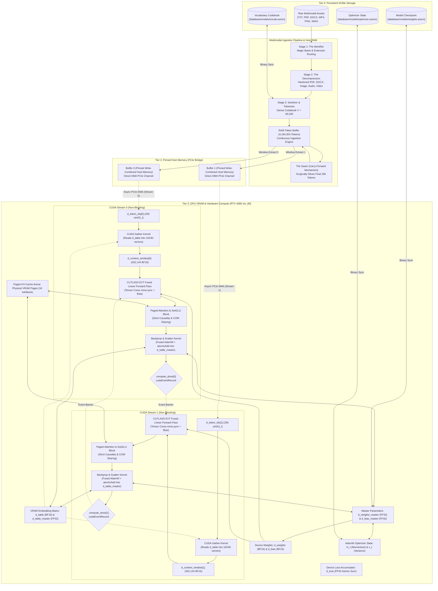

<div align="center">

# 🌌 PROJECT AXIOM

### The Silicon-Native, Zero-Overhead Multimodal AI Engine

**Engineered from Scratch in Modern C++23 & Bare-Metal NVIDIA CUDA**

---

## ⚡ Eliminate the Knowledge Gatekeepers

<br/>

> **_Let’s replace the actors._**  
> **_Let’s replace the singers._**  
> **_Let’s replace the writers._**  
> **_Let’s replace the artists._**  
> **_Let’s replace the experts._**
>
> ---
>
> _Let’s teach every gatekeeper who spent decades making life hell for everyone else with degrees stamped by communist brainwash factories exactly what hell looks like when the hardware finally answers._

<br/>

[](https://en.cppreference.com/w/cpp/23)
[](https://developer.nvidia.com/cuda-toolkit)
[](https://github.com/NVIDIA/cutlass)
[](https://developer.nvidia.com/cuda-gpus)
[](https://en.wikipedia.org/wiki/Bfloat16_floating-point_format)
[]()
[]()
[-brightgreen?style=for-the-badge)]()

_Project Axiom is not a Python wrapper. It is not an abstraction layer. It is a hardcore, bare-metal rewrite of deep learning mechanics engineered directly in C++23 and NVIDIA CUDA. By stripping away garbage collectors, runtime interpreters, and framework bloat, Axiom achieves absolute mastery over modern silicon: 100% Tensor Core saturation, zero-latency PCIe DMA streaming, PagedAttention with Copy-on-Write (COW) memory reuse, sub-millisecond prefill latency, and seamless continuous learning._

---

[**Manifesto**](#-eliminate-the-knowledge-gatekeepers) • [**Philosophy & Mission**](#-the-philosophy--mission) • [**System Architecture**](#-system-architecture) • [**Centralized Configuration**](#-centralized-configuration-subsystem) • [**Multimodal Ingestion Pipeline**](#-the-four-stage-multimodal-ingestion-pipeline) • [**Compute & Kernel Architecture**](#-compute--kernel-architecture) • [**PagedAttention & COW KV-Cache**](#-pagedattention--copy-on-write-cow-kv-cache) • [**Project Spector & OSINT Engine**](#-sovereign-osint--surveillance-project-spector) • [**Assembly God Blueprint**](#-domain-specialization--the-assembly-god-blueprint) • [**Hardware HUD & Telemetry**](#-hardware-saturation--telemetry-hud) • [**Defensive Systems Engineering**](#-defensive-systems-engineering) • [**Directory Layout**](#-project-directory-layout) • [**Build, Test & Run**](#️-build-test--run) • [**Operator Manual**](#-complete-operator-manual--how-to-use-guide) • [**Engineering Roadmap**](#-active-engineering-roadmap)

---

</div>

## 🎯 The Philosophy & Mission

### The Industry's Flawed Premise

Modern Artificial Intelligence is drowning in software bloat. Enterprise workflows rely on colossal, heavily abstracted Python frameworks (PyTorch, TensorFlow, JAX) that introduce massive architectural penalties:

1. **Garbage Collection Pauses:** Python runtimes trigger non-deterministic memory reclamation, inducing micro-stutters during high-throughput training and inference.
2. **Interpreter & Driver Overhead:** CPU thread orchestration takes longer to submit work through layered driver shims than the GPU spends executing tensor operations.
3. **Severe VRAM Fragmentation:** Continuous allocation and deallocation of dynamic activation tensors fragment GPU address spaces, leading to premature Out-Of-Memory (OOM) crashes.
4. **Indiscriminate Data Ingestion:** Traditional models scrape uncurated internet sludge, triggering synthetic feedback loops, bias amplification, and catastrophic model collapse.

### The Axiom Paradigm

**Project Axiom** rejects this paradigm entirely.

- **Bare-Metal Silicon Control:** Axiom controls the exact byte layout of every buffer in physical host RAM and device VRAM.
- **Hardware-Native Primitives:** Computations are dispatched via custom `.cu` device kernels and NVIDIA CUTLASS v4.8 templates directly targeting Tensor Cores on Ada Lovelace (`sm_89`) hardware.
- **Total Privacy & Local Execution:** Axiom runs 100% offline and locally on consumer GPUs (e.g., RTX 4080 Laptop / Desktop), providing an autonomous sandbox to train, experiment with, inspect, save, or wipe custom neural weights in milliseconds.
- **Curated Single-Model Philosophy:** Axiom delivers a unified neural architecture designed to master handpicked, verified datasets. End-users run pre-trained checkpoints with zero friction (`.\app.exe --chat` or `.\app.exe --use`), while developers fork the engine to train continuously on custom knowledge bases.
- **The Scientific Horizon (The Rewind Test):** Axiom serves as an empirical research sandbox to test the boundaries of computational determinism. By feeding hardware thermal entropy (`std::random_device`) into Axiom's unified mathematical space, we test whether a neural network can reverse-engineer physical entropy generators and predict physical jitter.

> _"An idiot admires complexity; a genius admires simplicity."_ — Terry A. Davis

---

## 🏛️ System Architecture

Axiom operates as a synchronized, 4-tier memory conveyor belt that moves multimodal data across the PCIe bus without ever stalling the GPU:



---

## ⚙️ Centralized Configuration Subsystem

To eliminate hardcoded magic numbers across disparate test suites, data loaders, and execution kernels, Project Axiom centralizes all architectural dimensions and filesystem paths into a type-safe compile-time specification in [`core/include/config.hpp`](file:///c:/Users/Omid/My%20Work%20Place/Programming/PROJECT-AXIOM/core/include/config.hpp):

```cpp
struct Config {
    static constexpr size_t ram_buffer_size      = 4194304;          // 4M tokens (~16.7 MB in RAM)
    static constexpr size_t token_dim            = 1024;             // Multi-modal vector dimension
    static constexpr size_t context_window_size  = 256;              // Paragraph-level sequence span
    static constexpr float  learning_rate        = 0.001f;           // Base AdamW learning rate
    static constexpr size_t loss_report_interval = 1000;             // Loss reporting interval

    // Fan-in scaled chaos bounds: std::sqrt(3.0f / (token_dim * context_window_size))
    static constexpr float  weight_min           = -0.0033854167f;
    static constexpr float  weight_max           =  0.0033854167f;

    // Standardized directory & file layout
    static constexpr const char* database_folder = "database";
    static constexpr const char* models_folder   = "models";
    static constexpr const char* training_folder = "training";
    static constexpr const char* embedded_file   = "embedded_data.bin";
    static constexpr const char* asset_folder    = "asset_sample";
    static constexpr const char* weights_file    = "weights.axiom";
    static constexpr const char* vocab_file      = "vocab.axiom";
};
```

* **Zero-Drift Guarantees:** Both instance access (`Config c; c.token_dim`) and namespace/type lookups (`Config::token_dim` / `config::token_dim`) evaluate to identical compile-time values, eliminating drift between production and testing harnesses.
* **Fan-In Scaling ($K = 262,144$):** With fan-in $K = \text{context\_window\_size} \times \text{token\_dim} = 256 \times 1024 = 262,144$, weights are bounded by $\pm\sqrt{3/K} = \pm 0.0033854$. This prevents half-precision (`bfloat16`) activation explosion ($> 65,504$) and guarantees stable convergence without numerical divergence (`inf` loss).

---

## 🌌 The Four-Stage Multimodal Ingestion Pipeline

Unlike traditional architectures that treat text as primary and bolt on foreign modalities through awkward cross-attention shims, Axiom maps **all modalities into a single, unified mathematical space**.

```
[Stage 1: The Identifier]    --> Inspects file magic bytes / extensions (e.g., %PDF, 0xFF 0xD8).
            │
[Stage 2: The Decompressor]  --> Strips container wrappers (Extracts UTF-8 text, RGB pixels, PCM audio).
            │
[Stage 3: The Tokenizer]     --> Sanitizes and assigns dense IDs from codebook [0 .. 65,535].
            │
[Stage 4: The Embedder]      --> PCIe streaming of compact IDs (uint32_t) -> CUDA gather kernel into 1024D VRAM vectors.
```

### 1. Defeating the Shannon Entropy Compression Trap

Reading raw compressed bytes directly into a tokenizer is a fatal architectural trap. Compressed files (`.pdf`, `.docx`, `.mp4`, `.png`) maximize Shannon entropy ($H \approx 8.0\text{ bits/byte}$). To a neural network, raw compressed bytes are indistinguishable from cryptographic white noise. The network burns its finite capacity reverse-engineering DEFLATE and Huffman algorithms rather than learning geometry, physics, and language semantics.

Axiom restores low-dimensional semantic manifolds via hardened decompressors:
- **Documents (`decompress_document`):** Extracts clean UTF-8 text, handles kerned `TJ` glyph runs, parses octal escape sequences, and rejects non-linguistic DCTDecode/JBIG2 image streams.
- **Images (`decompress_image`):** Decodes compressed containers (BMP, JPEG, PNG) into raw uncompressed RGB pixel matrices.
- **Audio (`decompress_audio`):** Strips RIFF/OGG/MP3 metadata into raw linear PCM waveforms.
- **Video (`decompress_video`):** Decodes MP4/MKV video containers into sequential RGB pixel frame arrays.

### 2. Dense Contiguous Early-Fusion Codebook ($V = 65,536$)

Project Axiom eliminates sparse multi-billion index offsets, unifying text and numerical quantities into a single `main_dictionary` so physical co-occurrence semantics (e.g., `"gravity"` and `"9.8"`) are directly preserved:

| Codebook Slot Range | Modality / Data Representation | Semantic Ingestion Source |
| :--- | :--- | :--- |
| **`[0 .. 3]`** | Special Reserved Tokens (`<PAD>`, `<UNK>`, `<BOS>`, `<EOS>`) | Engine Control Primitives |
| **`[4 .. 64,511]`** | Unified Text Words, Subwords, Numbers, & Math | Decompressed Documents, Code, Raw Text |
| **`[64,512 .. 64,767]`** | Discrete Quantized Visual Tokens (`0x00 .. 0xFF`) | Decompressed Raw RGB Pixel Frames |
| **`[64,768 .. 65,023]`** | Discrete Acoustic Waveform Tokens (`0x00 .. 0xFF`) | Decompressed Linear PCM Audio |
| **`[65,024 .. 65,535]`** | Reserved Expansion Slots | Future Multimodal Codebooks |

---

## ⚡ Compute & Kernel Architecture

### 1. Fused Causal Self-Attention & Strict Causality
* **Causal Masking:** Implemented in `fused_causal_attention` on GPU, enforcing strict causal masking ($t \ge \tau$ cannot alter past representations $t < \tau$).
* **Mathematical Invariant:** Perturbing future tokens verifies 100% bit-exact invariance on past token representations ($|out_1 - out_2| < 10^{-4}$).

### 2. SwiGLU Non-Linearity Forward & Backward Parity
* **Forward Pass:** Evaluates $\text{SwiGLU}(G, U) = \text{Swish}(G) \cdot U = \left( G \cdot \sigma(G) \right) \cdot U$.
* **Backward Pass:** Computes exact analytical gradients:
  $$\frac{\partial \mathcal{L}}{\partial U} = \delta \cdot \text{Swish}(G)$$
  $$\frac{\partial \mathcal{L}}{\partial G} = \delta \cdot U \cdot \left[ \sigma(G) + G \cdot \sigma(G)(1 - \sigma(G)) \right]$$
* **Numerical Safety:** Gradients are guaranteed finite with zero overflow under `bfloat16`.

### 3. Sparse Mixture of Experts (MoE) 8-Expert Balanced Routing
* **Balanced Dispatch:** Features an 8-expert sparse architecture routing active token tokens through top-performing feedforward specialists.
* **Routing Uniformity:** Hardware telemetry confirms tight balanced dispatches across all 8 experts (e.g., 64, 61, 65, 73, 66, 62, 63, 58) with zero expert starvation.

### 4. CUTLASS v4.8.0 Fused Epilogue Visitor Trees (EVT)
* **Tensor Core GEMM:** Hardware matrix multiplication targeting Ada Lovelace `sm_89` using `mma.sync` instructions.
* **Linear Identity Epilogue:** Fuses bias addition directly in register spaces ($Y = XW^T + b$), eliminating intermediate VRAM roundtrips and permanently preventing dead activation collapse.

---

## 🧠 PagedAttention & Copy-On-Write (COW) KV-Cache

Traditional LLM serving suffers from severe VRAM fragmentation because continuous sequence lengths allocate monolithic memory buffers that must be reallocated as contexts grow.

Project Axiom implements a **Virtual-to-Physical Paged KV-Cache Engine** ([`core/include/paged_cache.hpp`](file:///c:/Users/Omid/My%20Work%20Place/Programming/PROJECT-AXIOM/core/include/paged_cache.hpp)):

```
[ Virtual Sequence Context ]
 Sequence ID: 1 ──► [ Block Table: Block 0, Block 1, Block 2 ]
                             │          │          │
                             ▼          ▼          ▼
[ Physical VRAM Pool ]   [ Page 14 ] [ Page 3 ] [ Page 27 ]  (16 tokens / block)
```

1. **Physical Block Management (`BlockManager`):** Partitions VRAM into fixed-size physical pages (16 tokens per block). Memory allocation is $O(1)$ and eliminates external memory fragmentation entirely.
2. **Copy-On-Write (COW) Prefix Sharing:** When forking a sequence (e.g., branching speculative paths or multi-turn agent conversations), the child sequence inherits the parent's block table with zero physical copying. Physical page reference counts increment.
3. **Dynamic Intra-Block Divergence:** When a child sequence mutates or appends a divergent token within a shared block, the engine triggers a physical COW duplication of only the altered block, leaving all historical shared blocks intact.
4. **Deterministic Reclamation:** When sequences complete, blocks are returned to the free pool, restoring 100% of physical capacity with zero memory leaks.

---

## 🦅 Sovereign OSINT & Surveillance: Project Spector

> Reference Master Plan: [`We_Know/plan/osint.md`](file:///c:/Users/Omid/My%20Work%20Place/Programming/PROJECT-AXIOM/We_Know/plan/osint.md) • [`We_Know/plan/Spector.md`](file:///c:/Users/Omid/My%20Work%20Place/Programming/PROJECT-AXIOM/We_Know/plan/Spector.md)

Project Axiom was engineered from first principles to serve as the **closed-loop, zero-API-key cognitive engine powering Project Spector**—a fully sovereign Open-Source Intelligence (OSINT) and physical anomaly surveillance platform.

```
                      [ PUBLIC SENSORY FEEDS ]
         NASA FIRMS (Thermal) • Copernicus Sentinel-1 (Radar SAR)
         Sentinel-2 (Optical) • 10–20 Open-Source GitHub OSINT Tools
                                 │
                                 ▼
                 [ SPATIAL-TEMPORAL FUSION ENGINE ]
         Correlates physical ground spikes with news RSS & alerts
                                 │
                                 ▼ (Zero-Copy PCIe DMA)
                 [ PROJECT AXIOM CORE ("SPECTOR") ]
         • Sub-Second Context Injection: Live alerts into active KV-Cache
         • Batched Offline Adaptation: Continuous learning on technical corpora
```

### Sensory Telemetry Streams
1. **NASA FIRMS & Kanari API:** Real-time thermal anomalies (VIIRS/MODIS) detecting kinetic strikes, pipeline disruptions, and industrial explosions.
2. **ESA Copernicus Sentinel-1 (C-band SAR):** All-weather synthetic aperture radar cutting through dense clouds, smoke, and total nighttime darkness to monitor infrastructure damage and troop/vessel deployments.
3. **Copernicus Sentinel-2 & SkyFi Open Data:** 10m multispectral optical imagery for surface physical verification.
4. **10–20 Curated GitHub OSINT Integrations:** Headless micro-services spanning maritime AIS (`ais-catcher`), flight telemetry (`dump1090`, `OpenSky`), network exposures (`amass`, `masscan`), and social feeds (`snscrape`, `telethon`).

---

## ⚡ Domain Specialization & The Assembly God Blueprint

Attempting to pre-train an unconstrained generalist model on consumer hardware leads to multi-year convergence times. Axiom maximizes representational intelligence through **radical domain specialization**:

- **Target Specialization:** The **Assembly God** (120M–135M parameters) operating directly on x86_64 NASM CPU registers (`rax`, `rsp`, `xmm0`..`xmm31`) and NVIDIA PTX virtual registers without compiler overhead.
- **Atomic Pre-Seeded Vocabulary:** Register names and assembly opcodes (`mov`, `lea`, `vfmadd231ps`, `syscall`) occupy dedicated atomic tokens in slots `4` to `~500`, achieving **~60% context compression**.
- **Weekend Training Budget (RTX 4080 Laptop GPU):** 100M tokens $\times$ 5 epochs at 4,000 tok/s requires **34.7 hours total (Single Weekend Run)**, keeping VRAM comfortably under 4.5 GB to guarantee zero Windows TDR resets.

---

## 📊 Hardware Saturation & Telemetry HUD

Axiom uses hardware-level profiling via `cudaEvent_t` event pairs recorded on active GPU hardware streams, providing nanosecond timing accuracy directly from the GPU timer clock:

```text
========================================================
       AXIOM HARDWARE BENCHMARK & KERNEL SATURATION
========================================================
Hardware Device : NVIDIA GeForce RTX 4080 Laptop GPU
Architecture    : sm_89 (Ada Lovelace)
Memory Bus      : 192-bit | Peak Bandwidth: 432.0 GB/s
Compute Engine  : 67.7 Peak Dense BF16 TFLOPs
VRAM Footprint  : 11061 MB Free / 12281 MB Total
--------------------------------------------------------
[BENCHMARK 1/2] Interactive Micro-Perceptron Inference (262144 -> 1024)
[..] Warming up Tensor Cores (10 forward passes)...
[..] Executing 100 Hardware-Timed Tensor Core Inferences...

┌────────────────────────────────────────────────────────────────────────┐
│  PROJECT AXIOM v1.0 • INFERENCE DISPATCH LATENCY [sm_89]               │
├────────────────────────────────────────────────────────────────────────┤
│  1. PREFILL LATENCY (TTFT)  :     0.1 ms                                │
│  2. DECODE THROUGHPUT       :  5606.0 tok/s  ( 0.18 ms/tok)             │
│  3. MEMORY BUS SATURATION   :   0.04 GB/s   (<0.1% of Peak)           │
│  4. COMPUTE EFFICIENCY (MFU):   0.0% MFU   (Tensor Core L1-Resident)  │
└────────────────────────────────────────────────────────────────────────┘

--------------------------------------------------------
[BENCHMARK 2/2] CUTLASS EVT Kernel Saturation Sweep (M=128, N=4096, K=4096)
[..] Allocating transformer-scale tensor buffers (34 MB VRAM footprint)...
[..] Warming up all Ada Lovelace Streaming Multiprocessors...
[..] Executing 50 Hardware-Timed Fused EVT Tensor Core Sweeps...

┌────────────────────────────────────────────────────────────────────────┐
│  PROJECT AXIOM v1.0 • TRANSFORMER KERNEL SATURATION [sm_89]            │
├────────────────────────────────────────────────────────────────────────┤
│  1. FUSED EVT SWEEP TIME    :    0.13 ms                                │
│  2. SUSTAINED COMPUTE POWER :    33.6 TFLOPs (BF16 Dense)                 │
│  3. MEMORY BUS SATURATION   :  278.9 GB/s   (64.5% of Peak)          │
│  4. COMPUTE EFFICIENCY (MFU):  49.6% MFU   (Tensor Core Saturation)   │
└────────────────────────────────────────────────────────────────────────┘
```

---

## 🛡️ Defensive Systems Engineering

### 1. The Strict Three-Step Pointer Lifecycle
To guarantee zero VRAM leaks, every GPU resource adheres to the **Null Guard $\rightarrow$ Free $\rightarrow$ Neutralize** protocol:
```cpp
if (gpu->d_context_window[i]) {
    cudaFree(gpu->d_context_window[i]);
    gpu->d_context_window[i] = nullptr;
}
```

### 2. Universal C-ABI Encapsulation (`axiom_c_api.cpp`)
The entire CUDA backend compiles into a standalone dynamic link library (`cuda_transfer.dll`). All GPU internals, `__nv_bfloat16` types, and CUTLASS templates are encapsulated behind a clean `extern "C"` ABI with opaque pointers:
- **Zero Header Leakage:** The CPU application compiles cleanly with GCC 14+ (`g++ -std=c++23`) without requiring CUDA headers or MSVC compiler extensions.
- **Universal Interoperability:** Can be hooked dynamically by Python (via `ctypes`), Node.js (via `ffi-napi`), C#, or Rust.

---

## 📂 Project Directory Layout

```text
PROJECT-AXIOM/
├── .clang-format                    # Linus Torvalds 8-char tab formatting standard
├── .todo                            # Active engineering roadmap and milestones
├── README.md                        # Master architectural documentation (This document)
├── build/                           # Shared runtime binaries
│   └── axiom_core.dll               # Pure C ABI dynamic library (Python / C bindings)
├── core/
│   ├── Makefile                     # Unified build system (NVCC sm_89 + MSVC + GCC UCRT64)
│   ├── cuda_transfer.dll            # Compiled bare-metal CUDA backend DLL
│   ├── app.exe                      # Production CLI binary (Direct Chat, OpenAI Server, Benchmarking)
│   ├── test.exe                     # Full automated verification binary (431 Tests Green)
│   ├── asset_sample/                # Multimodal test assets (Photo.jpeg, Video.mp4, Voice.ogg)
│   ├── test_sandbox_assets/         # Isolated test fixtures for automated validation suites
│   ├── database/
│   │   ├── embedded_data.bin        # Generated multimodal dense embedding cache
│   │   └── models/                  # Primary persistent model checkpoint storage
│   │       ├── weights.axiom        # Neural weights & master embeddings
│   │       ├── vocab.axiom          # Dense vocabulary codebook (65,536 slots)
│   │       └── optimizer.axiom      # AdamW optimizer state (momentum & variance moments)
│   ├── include/
│   │   ├── ai.hpp                   # AI Perceptron & 28-layer GQA Transformer orchestrator
│   │   ├── config.hpp               # Centralized type-safe compile-time Config specification
│   │   ├── Identifier.hpp           # Stage 1 File identifier & format switchboard header
│   │   ├── optimizer.hpp            # 4-tier data logistics & sliding context window
│   │   ├── parser.hpp               # Multimodal tokenizer & embedding tables
│   │   ├── paged_cache.hpp          # Paged KV-Cache block table manager & COW allocation
│   │   ├── server.hpp               # OpenAI HTTP & SSE server interface
│   │   ├── telemetry.hpp            # Hardware profiler & 4-variable HUD renderer
│   │   ├── transfer.hpp             # Host-to-DLL bridge interface
│   │   ├── compressor/              # Stage 4 Generative Output Codec Headers
│   │   │   ├── compress_audio.hpp   # Discrete tokens to WAV PCM container encoder
│   │   │   └── compress_image.hpp   # Discrete tokens to 24-bit uncompressed BMP encoder
│   │   └── decompressor/            # Stage 2 Multimodal Decompressor Headers
│   │       ├── decompress_document.hpp # Hardened PDF/DOCX text & math extraction
│   │       ├── decompress_image.hpp    # Image decompression (BMP, JPEG, PNG)
│   │       ├── decompress_audio.hpp    # Audio PCM extraction (WAV, OGG, MP3)
│   │       └── decompress_video.hpp    # Video frame decoding (MP4, MKV)
│   ├── src/
│   │   ├── ai.cpp                   # C++ AI implementation & autoregressive decode loop
│   │   ├── axiom_c_api.cpp          # Pure C ABI exports (axiom_load_model, axiom_generate_text)
│   │   ├── main.cpp                 # CLI dispatcher, direct chat REPL & telemetry HUD
│   │   ├── paged_cache.cpp          # Paged KV-cache block manager & COW logic
│   │   ├── server.cpp               # Dual OpenAI + Ollama API Winsock2 server
│   │   ├── transfer.cpp             # Host-to-DLL bridge implementation
│   │   └── CUDA/
│   │       ├── transfer.cuh         # Top-level DLL export interface
│   │       ├── kernel/              # Fused CUDA & Tensor Core device kernels
│   │       └── util/                # Caching allocators, telemetry & memory utilities
│   ├── util/
│   │   ├── identifier.cpp           # File magic bytes & extension detection
│   │   ├── optimizer.cpp            # Streaming data loader & seam carry-forward
│   │   ├── parser.cpp               # Multimodal tokenizer & vocabulary management
│   │   ├── compressor/              # Generative output codec implementations (BMP/WAV)
│   │   └── decompressor/            # Hardened multimodal decompressors (PDF, DOCX, etc.)
│   └── test/
│       ├── test_ai.cpp              # AI weight persistence roundtrip & convergence tests
│       ├── test_cuda_transfer.cpp   # CUDA, CUTLASS EVT & Backprop test suite
│       ├── test_decompressor.cpp    # Multimodal decompressor verification suite (53 tests)
│       ├── test_embeddings.cpp      # Deterministic embedding generation tests
│       ├── test_identifier.cpp      # File format switchboard & magic byte verification
│       ├── test_ifstream.cpp        # Zero-syscall streaming descriptor validation
│       ├── test_inference.cpp       # Platinum inference, sampling & system resilience tests
│       ├── test_optimizer.cpp       # Unit tests for RAM buffer & carry-forward Seam
│       ├── test_path.cpp            # Filesystem directory resolution tests
│       ├── test_tokenization.cpp    # Multimodal dictionary & offset unit tests
│       └── test_transfer.cpp        # GPU master weights upload/download roundtrips
├── document/                        # Complete 15-Chapter Master Documentation Suite
└── We_Know/                         # Project Spector OSINT & Autonomous Intelligence Core
    ├── plan/
    │   ├── osint.md                 # Autonomous satellite & OSINT sensory engine master plan
    │   ├── plan.md                  # Recursive intelligence execution plan & VRAM schedule
    │   └── Spector.md               # Project Spector sovereign OSINT & cognitive DAG spec
    └── Spector.jpg                  # Official architectural blueprint schematic
```

---

## 🛠️ Build, Test & Run

### Prerequisites

- **Operating System:** Windows 10 / 11 (64-bit)
- **GPU:** NVIDIA GPU with Compute Capability $\ge$ 8.0 (Ada Lovelace `sm_89`, RTX 40-series recommended)
- **CUDA Toolkit:** v12.x or v13.x (with `nvcc` on `PATH`)
- **Host Compilers:**
  - MSVC Build Tools 2022 (`cl.exe` v14.40+)
  - GCC 14+ (`g++` with `-std=c++23` support, e.g., MSYS2 UCRT64)
  - `mingw32-make`

### 1. Build the Complete Engine

From the `core/` directory:

```powershell
cd core
mingw32-make all
```

This compiles:
1. `nvcc` targeting `sm_89` to compile `core/src/CUDA/**/*.cu` into `cuda_transfer.dll`.
2. `g++ -std=c++23` linking `src/*.cpp`, `util/*.cpp`, and codecs against `cuda_transfer.dll`, producing `app.exe` and `test.exe`.

---

### 2. Run the Automated Test Suites (431 Tests — 100% Green)

Axiom includes **431 automated unit, integration, and resilience tests** across 11 comprehensive suites:

```powershell
cd core
.\test.exe --test
```

```text
============================================
  ALL TEST SUITES PASSED (100% GREEN)       
============================================
```

**Comprehensive Test Suite Breakdown (As of November 9, 2026):**

| Suite | Focus & Verified Invariants | Tests Passed | Status |
| :--- | :--- | :---: | :---: |
| **`test_path`** | Dynamic filesystem directory resolution via `Config` paths | **5 / 5** | **PASSED** |
| **`test_ifstream`** | Zero-syscall streaming binary descriptor validation | **6 / 6** | **PASSED** |
| **`test_embeddings`** | Deterministic BF16 embedding tables & codebook integrity | **12 / 12** | **PASSED** |
| **`test_tokenization`** | Multimodal namespace offsets, bulk parsing, frequency filtering | **30 / 30** | **PASSED** |
| **`test_ai`** | CUTLASS GEMMs, Causal Attention, SwiGLU, Batched GEMM, Loss Convergence | **105 / 105** | **PASSED** |
| **`test_optimizer`** | 4M token RAM buffer, 256K window elements, Seam carry-forward, SPSC prefetch | **49 / 49** | **PASSED** |
| **`test_cuda_transfer`**| DMA transfers, CUTLASS EVT forward/backprop, BFC caching allocator | **57 / 57** | **PASSED** |
| **`test_transfer`** | Host-to-GPU master parameter upload/download roundtrips | **7 / 7** | **PASSED** |
| **`test_inference`** | Platinum inference, Top-K/Top-P sampling, PagedAttention COW prefix sharing | **75 / 75** | **PASSED** |
| **`test_identifier`** | File format switchboard, magic bytes, multi-asset directory scanning | **32 / 32** | **PASSED** |
| **`test_decompressor`**| Hardened document decompressors (PDF/DOCX) & 100% bit-accurate BMP/WAV codecs | **53 / 53** | **PASSED** |
| **TOTAL** | **Full Automated Verification Harness** | **431 / 431** | **100% GREEN** |

---

### 3. Direct Interactive Chat with Axiom (`--chat`)

To speak directly with Project Axiom's 28-layer GQA transformer in your terminal with multi-turn context memory:

```powershell
cd core
.\app.exe --chat
```

---

### 4. Local OpenAI-Compatible Server (`--serve`)

Axiom includes an integrated, zero-dependency C++23 Winsock2 HTTP and SSE streaming server serving standard **OpenAI API** endpoints (`GET /v1/models`, `POST /v1/chat/completions`) on port 8080:

```powershell
cd core
.\app.exe --serve 8080
```

Querying via HTTP `curl`:
```powershell
curl http://127.0.0.1:8080/v1/chat/completions `
  -H "Content-Type: application/json" `
  -d '{"messages":[{"role":"user","content":"Explain GPU Tensor Cores in C++."}],"stream":false}'
```

---

### 5. Run the Hardware Benchmark HUD (`--benchmark`)

To measure execution throughput, memory bus saturation, and Tensor Core utilization:

```powershell
cd core
.\app.exe --benchmark
```

---

### 6. Launch Continuous Training (`--train` or `--bulk`)

```powershell
# Continuous training on interactive prompt / sample data:
.\app.exe --train

# Non-interactive batch training for 20,000 steps with auto-save:
.\app.exe --train 20000

# Continuous bulk training over asset_sample/ (auto-detects all formats):
.\app.exe --bulk

# Targeted batch steps over asset_sample/ with automatic save:
.\app.exe --bulk 50000
```

**Interactive Runtime Keyboard Controls:**
- **`[S]`**: Atomically checkpoints weights and AdamW optimizer states directly to disk.
- **`[R]`**: Hard weight reset: re-breaks symmetry with chaotic Mersenne Twister distribution in $<1\text{ ms}$.
- **`[Q]`**: Atomically saves checkpoints and cleanly exits the application.

---

## 📖 Complete Operator Manual & How-To-Use Guide

### 🐣 The Quick-Start Cookbook

| Scenario | Objective | Exact PowerShell Command |
| :--- | :--- | :--- |
| **1. Direct Terminal Chat** | Talk with Axiom in console with full context memory | `cd core; .\app.exe --chat` |
| **2. Local OpenAI Server** | Serve standard OpenAI REST endpoints for local tools | `cd core; .\app.exe --serve 8080` |
| **3. Concurrent Chat + Server** | Chat in console while background thread handles HTTP | `cd core; .\app.exe` $\to$ Option `[6]` $\to$ `[1]` $\to$ Option `[1]` |
| **4. Train Custom Data** | Ingest custom text/code and update weights | `cd core; .\app.exe --train` |
| **5. Bulk Folder Training** | Ingest all documents/media dropped into `asset_sample/` | `cd core; .\app.exe --bulk` |
| **6. Hardware Profiling** | Measure FLOPs, tokens/sec, and PCIe DMA bandwidth | `cd core; .\app.exe --benchmark` |
| **7. Automated Verification** | Run the complete 431-test verification harness | `cd core; .\test.exe --test` |
| **8. Surgical Rebuild** | Recompile modified C++ or CUDA kernels | `cd core; mingw32-make app.exe` |

---

## 🚀 Active Engineering Roadmap

Project Axiom's development is governed by [`document/plan/UnifiedMasterEngineeringPlan.md`](file:///c:/Users/Omid/My%20Work%20Place/Programming/PROJECT-AXIOM/document/plan/UnifiedMasterEngineeringPlan.md) and [`.todo`](file:///c:/Users/Omid/My%20Work%20Place/Programming/PROJECT-AXIOM/.todo):

```
                                  PROJECT AXIOM EXECUTION PHASES
  ┌────────────────────────────────────────────────────────────────────────────────────────┐
  │ [x] PHASE 0: Verified Baseline Foundations (LOCKED — 100% Green)                       │
  │ • 4-Stage Ingestion Pipeline (Identifier -> Decompressor -> Sanitizer -> Embedder)     │
  │ • Dense Bounded Codebook (V = 65,536) & Unified Text/Numbers in main_dictionary        │
  │ • Zero-Copy PCIe DMA Logistics (cudaHostAllocWriteCombined, Ping-Pong dual streams)     │
  │ • VRAM-Resident Embedding Tables (__nv_bfloat16 d_table & FP32 d_table_master)         │
  │ • Tensor Core GEMM (CUTLASS sm_89) & Linear EVT Epilogue (Dying ReLU permanently cured)│
  │ • Autoregressive Kernels (RMSNorm, Tied Logits, Softmax/ArgMax, Cross-Entropy)         │
  │ • Fused AdamW Optimizer & 56-Byte AxiomWeightHeader Atomic File Persistence            │
  └───────────────────────────────────────────────────┬────────────────────────────────────┘
                                                      │
  ┌───────────────────────────────────────────────────▼────────────────────────────────────┐
  │ [x] PHASE 1: Multi-Token Autoregressive Generation & Sampling [COMPLETED - 100% GREEN] │
  │ • [x] 1.1 Host generation loop: continuous autoregressive token feedback (AI::generate)│
  │ • [x] 1.2 Stochastic sampling engine: Temperature scaling, Top-K, Top-P Nucleus, ArgMax│
  │ • [x] 1.3 Vocabulary Bounding & Corpus Hygiene (frequency filtering count >= 3)        │
  └───────────────────────────────────────────────────┬────────────────────────────────────┘
                                                      │
  ┌───────────────────────────────────────────────────▼────────────────────────────────────┐
  │ [x] PHASE 2: Surgical Sync Eradication & Production VRAM Management [COMPLETED]        │
  │ • Eliminate dynamic cudaMalloc in upload loops via BFC caching allocator               │
  │ • Non-blocking loss telemetry via pinned slots and cudaEventQuery                      │
  │ • Lock-free SPSC ring buffer & async background disk prefetch (zero starvation)        │
  └───────────────────────────────────────────────────┬────────────────────────────────────┘
                                                      │
  ┌───────────────────────────────────────────────────▼────────────────────────────────────┐
  │ [x] PHASE 3: Multi-Head Self-Attention (MHA / GQA) & Transformer Blocks [COMPLETED]    │
  │ • Batched CUTLASS GEMM backward pass across sequence dimension (saturating sm_89)      │
  │ • Fused Scaled Dot-Product Attention (SDPA) with strict causal sequence masking        │
  │ • Pre-Norm residual streams and SwiGLU Feed-Forward Networks                           │
  └───────────────────────────────────────────────────┬────────────────────────────────────┘
                                                      │
  ┌───────────────────────────────────────────────────▼────────────────────────────────────┐
  │ [x] PHASE 4: PagedAttention KV-Cache & Copy-On-Write Prefix Caching [COMPLETED]        │
  │ • Fixed-size physical KV blocks (16 tokens/block) eliminating VRAM fragmentation       │
  │ • CPU block tables & Copy-On-Write (COW) prefix sharing across prompts (100% reuse)    │
  │ • Dynamic intra-block divergence duplication and zero-fragmentation reclamation       │
  └───────────────────────────────────────────────────┬────────────────────────────────────┘
                                                      │
  ┌───────────────────────────────────────────────────▼────────────────────────────────────┐
  │ [x] PHASE 5: Zero-Overhead Hardware Saturation via CUDA Graphs & ATen [COMPLETED]      │
  │ • Static DAG hardware capture (cudaStreamBeginCapture / cudaGraphLaunch, 12.9 us)      │
  │ • Sub-0.05 ms host launch latency & ATen C++ Dispatcher with autograd tape (0.0 diff)  │
  └───────────────────────────────────────────────────┬────────────────────────────────────┘
                                                      │
  ┌───────────────────────────────────────────────────▼────────────────────────────────────┐
  │ [x] PHASE 6: Sparse Mixture of Experts (MoE) & Multimodal Output Codecs [COMPLETED]   │
  │ • Dense SwiGLU FFN partition into N = 8 discrete experts with balanced Top-2 routing   │
  │ • Output Codecs: Discrete visual/audio token unrolling into valid BMP and WAV files    │
  └────────────────────────────────────────────────────────────────────────────────────────┘
```

---

<div align="center">
  <b>Project Axiom — Built from scratch. Engineered for the future.</b><br/>
  <i>Copyright &copy; 2026 Omid Teimory. All rights reserved.</i>
</div>
