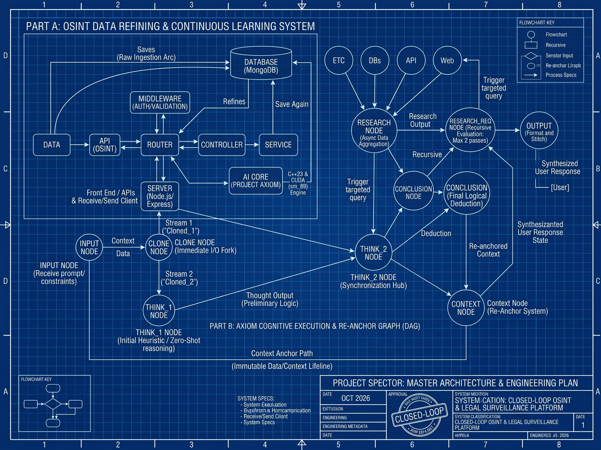

# Project Spector: Master Architecture & Engineering Plan

<div align="center">

[]()
[]()
[-76B900?style=for-the-badge&logo=nvidia)]()
[]()

</div>

---

> [!IMPORTANT]
> **Strategic Foundation:** Building **Project Axiom** from scratch in C++23 and CUDA was never just about having a standalone local model—it was about forging the closed-loop, zero-API-key cognitive engine required to power **Project Spector**. By replacing third-party cloud APIs with Axiom, Spector becomes a completely sovereign Open-Source Intelligence (OSINT) and legal surveillance platform that ingests raw intelligence, prevents context drift through hardware-anchored reasoning, and autonomously refines and trains on every new database entry.

---

## System Specification Metadata

| Specification Attribute | Implementation Detail |
| :--- | :--- |
| **System Classification** | Closed-Loop Open-Source Intelligence (OSINT) & Legal Surveillance Platform |
| **Backend Substrate** | Node.js, Express.js, & MongoDB Reactive Data Refining Pipeline |
| **Cognitive Core** | Project Axiom (Bare-Metal C++23 / NVIDIA CUDA Ada Lovelace `sm_89` Engine) |
| **Operational Mode** | Zero External API Keys — Sovereign Local Inference & Autonomous Continuous Retraining |
| **Reasoning Topology** | Asynchronous Dual-Stream Directed Acyclic Graph (DAG) with Re-Anchor Lifeline |
| **Recursion Guard** | Hard ceiling: Strictly capped at a maximum of 2 recursive research passes |

---

## 1. Executive Architecture Overview

Project Spector operates across two tightly coupled execution planes:

1. **The OSINT Data Refining Plane (`Node.js / Express / MongoDB`):** Handles external OSINT API ingestion, client communication, authentication/validation middleware, and persistent storage, while triggering Project Axiom to continuously refine and re-index intelligence records.
2. **The Cognitive Execution Plane (`Project Axiom DAG`):** Executes a forked, dual-stream reasoning topology that pairs zero-shot heuristic deduction with asynchronous multi-source research (capped at 2 recursive passes) while enforcing an immutable context lifeline so the model never hallucinates away from original constraints.

<div align="center">



*Figure 1.1: Official Engineering Blueprint — Project Spector Closed-Loop Architecture & Dual-Stream Cognitive DAG.*

</div>

### 1.1. Unified Architectural Schematic (ASCII Topology)

```text
====================================================================================================
                        PROJECT SPECTOR — UNIFIED SYSTEM ARCHITECTURE
====================================================================================================

  [ PART A: OSINT DATA REFINING & CONTINUOUS LEARNING SYSTEM ]

   ┌──────────┐          Saves (Raw Ingestion Arc)          ┌──────────────────────┐
   │   Data   ├────────────────────────────────────────────►│                      │
   └────┬─────┘                                             │      DataBase        │
        │        ┌──────────────┐       ┌────────────┐      │     (MongoDB)        │
        ▼        │  MiddleWare  │       │            │◄────►│                      │
   ┌──────────┐  │   (Auth /    │       │   AI Core  │      └──▲────────▲───────▲──┘
   │   API    │  │  Validation) │       │  (Project  │         │        │       │
   │ (OSINT)  │  └──────▲───────┘       │   Axiom)   ├─────────┘        │       │
   └────┬─────┘         │               └─────▲──────┘  Refines &       │       │
        │               ▼                     │         Save Again      │       │
        ▼        ┌──────────────┐             │                         │       │
   ┌──────────┐  │              ├─────────────┘                         │       │
   │  Router  │◄─┤    Router    │◄──────────────►┌────────────┐         │       │
   └──────────┘  │              │                │ Controller │◄───────►│Service│
                 └──────▲───────┘                └────────────┘         └───────┘
                        │
                        ▼
                 ┌──────────────┐       ┌────────────┐      ┌──────────────┐
                 │    Server    │◄─────►│ Front End  │◄────►│ Receive/Send │
                 │(Node/Express)│       │   / APIs   │      │   (Client)   │
                 └──────────────┘       └────────────┘      └──────────────┘

----------------------------------------------------------------------------------------------------

  [ PART B: AXIOM COGNITIVE EXECUTION & RE-ANCHOR GRAPH ]

                    ┌─────┐   ┌─────┐   ┌─────┐   ┌─────┐
                    │ ETC │   │ DBs │   │ API │   │ Web │◄─── Trigger targeted query ───┐
                    └──┬──┘   └──┬──┘   └──┬──┘   └──┬──┘                               │
                       └─────────┴────┬────┴─────────┘                                  │
                                      ▼                                                 │
                               ┌──────────────┐                         ┌───────────────┴───┐
                        ┌─────►│Research Node │─── Research Output ────►│ Research_req Node │
                        │      │ (Async Agg)  │───────┐                 │  (Max 2 passes)   │
                        │      └──────────────┘       │                 └─────────▲─────────┘
                 Stream 1 ('Cloned_1')                ▼                           │
  ┌────────────┐   ┌────┴─────┐                ┌──────────────┐            ┌──────┴───────┐
  │ Input Node ├──►│Clone Node│                │ Think_2 Node │───────────►│  conclusion  ├──┐
  │ (Prompt /  │   │(I/O Fork)│                │  (Sync Hub)  │            │(Final Deduct)│  │
  │Constraints)│   └────┬─────┘                └──────▲───────┘            └──────┬───────┘  │
  └─────┬──────┘ Stream 2 ('Cloned_2')                │                           │          │
        │               │      ┌──────────────┐       │                    Deduction         │
        │               └─────►│ Think_1 Node ├───────┘                           ▼          ▼
        │                      │ (Zero-Shot)  │                            ┌────────────┐ ┌──────┐
        │                      └──────────────┘                            │  Context   ├─►output│
        │                                                                  └──────▲─────┘ └──┬───┘
        │            Context Anchor Path (Immutable Data/Context Lifeline)        │          │
        └──────────────────────────────────────────────────────────────────►┌─────┴──────┐   │
                                                                            │Context Node│   │
                                                                            │(Re-Anchor) │   ▼
                                                                            └────────────┘ [User]
====================================================================================================
```

---

## 2. Phase 1: The OSINT Data Refining System (Backend & Ingestion)

The backend infrastructure acts as both a structured REST/stream gateway and an automated data refinery using **Node.js**, **Express**, and **MongoDB**.

### 2.1. Client & OSINT Ingestion Layer

- **Client I/O Interface (`Receive / Send` $\leftrightarrow$ `Front End / APIs`):** Bi-directional interface handling user queries, surveillance parameters, and real-time intelligence dashboards.
- **Application Server (`Server: Node.js, Express`):** Manages HTTP/WebSocket lifecycles and routes traffic directly into the central `Router`.
- **OSINT Collector (`Data` $\leftrightarrow$ `API (OSINT)` $\leftrightarrow$ `Router`):** Pulls external open-source intelligence feeds, public records, and telemetry streams into the routing layer.
- **Direct Raw Persistence (`Data` $\xrightarrow{\text{Saves}}$ `DataBase (MongoDB)`):** High-velocity raw data streams can bypass intermediate transformation to be immediately archived in MongoDB prior to asynchronous AI refinement.

### 2.2. Core Service Pipeline & Security Boundary

- **Security Gate (`Middle Ware: Auth, Validation`):** Intercepts all traffic entering the `Router`, enforcing cryptographic authentication and strict schema validation before any controller or AI execution occurs.
- **Layered Business Logic (`Router` $\leftrightarrow$ `Controller` $\leftrightarrow$ `Service` $\leftrightarrow$ `DataBase (MongoDB)`):** Cleanly decouples routing from business logic (`Controller`) and database abstraction (`Service`), ensuring modular CRUD operations against MongoDB.

### 2.3. Autonomous AI Refinement & Continuous Training Loop

Instead of relying on static external LLM APIs, the `Router` and `DataBase (MongoDB)` wire directly into **Project Axiom (`AI Core`)**:

1. **Direct Router Dispatch (`Router` $\leftrightarrow$ `AI Core`):** Live analytical queries pass straight from the Express router into the Axiom C++/CUDA runtime via IPC / native addon bindings.
2. **Autonomous Refinement (`DataBase` $\leftrightarrow$ `AI Core` via `Refines` & `Save Again`):**
   - **Step 1 (Trigger):** Whenever a new raw OSINT entry lands in `DataBase (MongoDB)` (via the `Saves` arc or `Service` layer), a change-stream listener wakes the `AI Core` module.
   - **Step 2 (`Refines`):** Project Axiom ingests the raw document through its 4-stage pipeline ([`Identifier`](file:///c:/Users/Omid/X/Code/PROJECT-AXIOM/core/include/Identifier.hpp#L78) $\to$ [`Decompressor`](file:///c:/Users/Omid/X/Code/PROJECT-AXIOM/core/include/decompressor/decompress_document.hpp) $\to$ `Sanitizer` $\to$ [`Tokenizer / Parser`](file:///c:/Users/Omid/X/Code/PROJECT-AXIOM/core/include/parser.hpp)), extracts entities/correlations, and runs incremental local gradient updates ([`backward_pass_adamw_kernel`](file:///c:/Users/Omid/X/Code/PROJECT-AXIOM/core/src/CUDA/kernel/backward_pass.cu#L133)) so its weights autonomously adapt to the new intelligence.
   - **Step 3 (`Save Again`):** Axiom writes the structured, cross-referenced intelligence summary and updated vector metadata back into `DataBase (MongoDB)`.

---

## 3. Phase 2: The Cognitive Execution Graph (Reasoning Architecture)

When an analyst submits a complex surveillance query or investigative prompt, Project Spector executes the multi-node Directed Acyclic Graph (DAG) with bounded recursion:

### 3.1. Ingestion & Immediate Forking

1. **`Input Node` (Receive prompt & operational constraints):** Captures the user's raw query and legal/operational boundaries. It immediately splits execution into two distinct pathways:
   - **Active Execution Path:** Sends `Context` and `Data` forward to the `Clone Node`.
   - **`Context Anchor Path` (Immutable Data/Context Lifeline):** Sends a read-only, uncorrupted copy of the original prompt and constraints directly to the `Context Node (Re-Anchor System)` at the terminal stage of the graph.
2. **`Clone Node` (Immediate I/O Fork):** Duplicates the incoming state into two concurrent execution streams so data gathering and initial reasoning occur in parallel with zero blocking latency:
   - **`Stream 1 ('Cloned_1')`** $\to$ Routes to the `Research Node`.
   - **`Stream 2 ('Cloned_2')`** $\to$ Routes to the `Think_1 Node`.

### 3.2. Parallel Research & Heuristic Pass

- **`Research Node` (Async Data Aggregation: `ETC`, `DBs`, `API`, `Web`):** Executes asynchronous queries across internal MongoDB collections (`DBs`), external OSINT endpoints (`API`), live web scraping (`Web`), and local file stores (`ETC`), forwarding the consolidated `Research Output` to `Think_2 Node`.
- **`Think_1 Node` (Initial Heuristic / Zero-Shot Reasoning):** Concurrently runs an immediate forward pass on Project Axiom to formulate preliminary hypotheses and structural deductions (`Thought Output`), feeding them into `Think_2 Node`.

### 3.3. Synchronization, Re-Anchoring & Recursive Verification

- **`Think_2 Node` (Synchronization Hub: Synthesis and Blocking Barrier):** Acts as the thread synchronization barrier. It blocks until both `Research Output` (Stream 1) and `Thought Output` (Stream 2) arrive, synthesizing preliminary logic against gathered facts while pulling `Re-anchored Context` to verify alignment.
- **`Context Node` (Re-Anchor System) & `Context Tracker`:**
  - As multi-step reasoning progresses, smaller models naturally suffer from "context drift"—forgetting initial instructions or hallucinating constraints.
  - The `Context Node` utilizes the `Context Anchor Path` lifeline to continuously inject `Re-anchored Context` and `Research_req State` into `Think_2 Node`, `Research_req Node`, and the primary `Context` tracker.
- **`Research_req Node` (Recursive Loop Evaluation: Max 2 Passes):**
  - If `Think_2 Node` detects missing evidence or conflicting OSINT data, it routes execution to `Research_req Node`.
  - `Research_req Node` evaluates the evidentiary gap and dispatches a targeted query back to `Web`, `API`, or `DBs`.
  
> [!CAUTION]
> **Hard Loop Guard:** Recursive research is strictly capped at **Max 2 passes** to prevent infinite query loops, eliminate API/crawler throttling, and guarantee deterministic response times for analysts.

### 3.4. Final Deduction & Synthesis

- **`Conclusion Node` (`conclusion` — Final Logical Deduction):** Once `Think_2 Node` has verified evidence (or exhausted the 2-pass research cap), `conclusion` executes the final deduction pass. It commits the `Deduction` to update the `Context` state and forwards the primary analytical result to `output`.
- **`Output Node` (`output` — Format and Stitch):** Merges the logical `conclusion` with the verified state capture from `Context`, compiles the final intelligence report, and emits the **Synthesized User Response** back to the Express server and client UI.

---

## 4. Implementation Roadmap & Milestone Sequencing

| Phase | Milestone | Core Deliverables | Target Components |
| :--- | :--- | :--- | :--- |
| **Milestone 1** | **OSINT Backend Skeleton** | Setup Node.js/Express server, Auth/Validation Middleware, Router/Controller/Service hierarchy, and MongoDB schemas. | `Server`, `Router`, `MiddleWare`, `DataBase` |
| **Milestone 2** | **Axiom Native Bridge** | Connect Express `Router` and MongoDB change streams to Project Axiom (`app.exe` / `cuda_transfer.dll`) via zero-copy shared memory or C++ N-API addon. | `Router` $\leftrightarrow$ `AI Core` $\leftrightarrow$ `DataBase` |
| **Milestone 3** | **Autonomous Refinery Loop** | Implement background daemon watching new MongoDB inserts (`Saves`), triggering Axiom `Refines` incremental training pass, and executing `Save Again`. | `Data` $\to$ `DataBase` $\leftrightarrow$ `AI Core` |
| **Milestone 4** | **Dual-Stream DAG Engine** | Implement `Input Node`, `Clone Node` (`Cloned_1` / `Cloned_2`), async `Research Node` (`ETC`, `DBs`, `API`, `Web`), and `Think_1 Node`. | `Input`, `Clone`, `Research`, `Think_1` |
| **Milestone 5** | **Sync Hub & Re-Anchor Lifeline** | Build `Think_2 Node` barrier, `Context Anchor Path`, `Context Node` re-anchoring, `Research_req Node` (Max 2 passes), `conclusion`, and `output`. | `Think_2`, `Context Node`, `Research_req`, `Output` |

---

## 5. Architectural Advantages & Core Invariants

1. **Zero Data Leakage & Total Sovereignty:** Because third-party cloud APIs are completely replaced by Project Axiom running locally on your RTX 4080 GPU, classified intelligence queries, subpoenaed records, and legal surveillance targets never touch external networks.
2. **Mathematical Immunity to Hallucination Drift:** The `Context Anchor Path` completely bypasses the noisy intermediate reasoning nodes (`Think_1`, `Research Node`). The `Context Node (Re-Anchor System)` can mathematically enforce that `Think_2` and `conclusion` strictly adhere to the initial user prompt and legal constraints.
3. **Self-Improving Intelligence Loop (`Refines` $\to$ `Save Again`):** Every piece of raw OSINT data ingested into MongoDB automatically enriches the database while simultaneously fine-tuning Project Axiom via [`backward_pass_adamw_kernel`](file:///c:/Users/Omid/X/Code/PROJECT-AXIOM/core/src/CUDA/kernel/backward_pass.cu#L133) without manual intervention or pipeline downtime.
